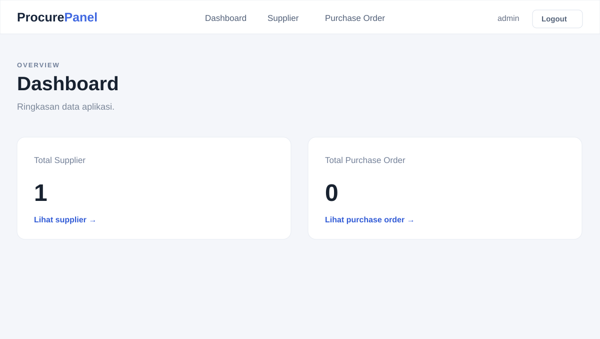
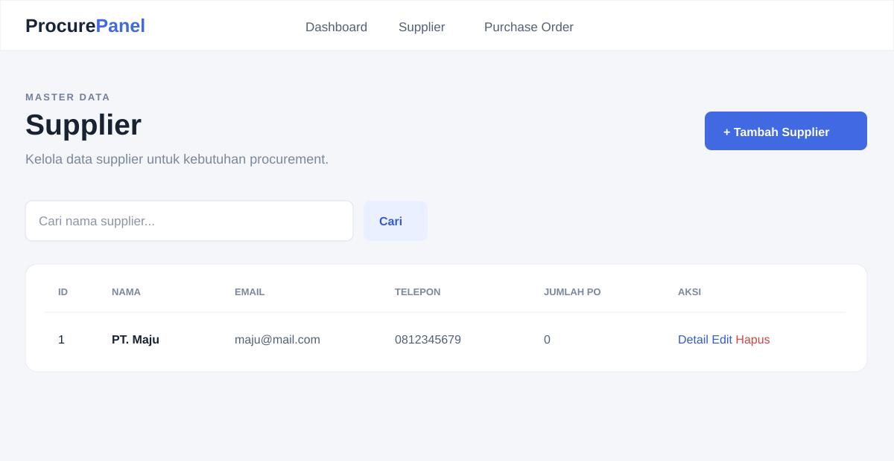
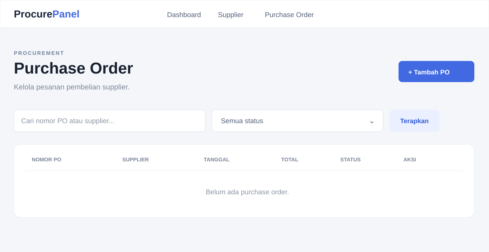
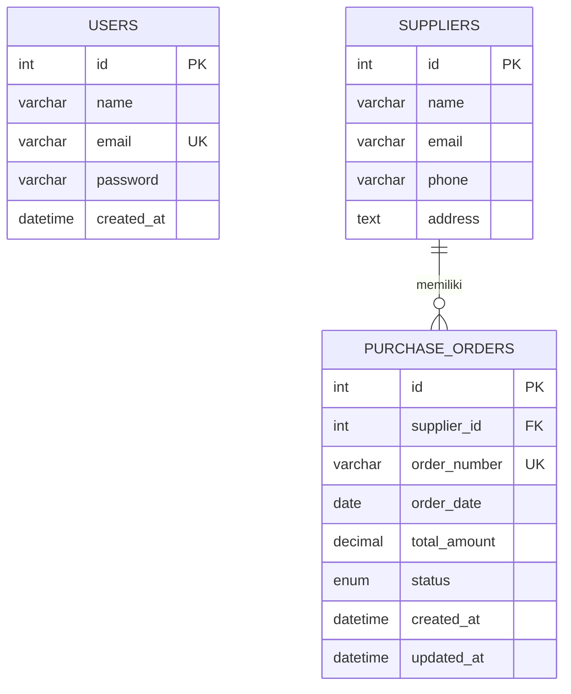

# ProcurePanel

Sistem pengelolaan **supplier dan purchase order** sederhana untuk kebutuhan
administrasi procurement. Aplikasi ini dibuat sebagai aplikasi web server-side
rendered menggunakan NestJS, TypeORM, MySQL, dan EJS.

Fokus aplikasi adalah alur bisnis inti yang mudah dipahami:

1. Administrator login.
2. Administrator mencatat dan mengelola supplier.
3. Administrator membuat purchase order untuk satu supplier.
4. Administrator mencari PO berdasarkan nomor PO atau nama supplier.
5. Administrator memfilter PO berdasarkan status dan melihat detailnya.

Project ini sengaja dibuat sederhana. Belum ada modul item/barang PO,
approval bertingkat, role permission, upload dokumen, pagination, atau REST API
terpisah.

## Fitur

- Login administrator berbasis session.
- Pembuatan, pembacaan, perubahan, dan penghapusan supplier.
- Pembuatan, pembacaan, perubahan, dan penghapusan purchase order.
- Relasi satu supplier memiliki banyak purchase order.
- Halaman detail supplier dan purchase order.
- Pencarian berdasarkan nomor PO atau nama supplier.
- Filter status purchase order.
- Dashboard ringkas berisi jumlah supplier dan purchase order.
- Validasi input menggunakan `class-validator`.
- Error HTML terpusat melalui exception filter.

## Screenshot aplikasi

Preview berikut diambil dari tampilan aplikasi lokal setelah login sebagai
administrator.

### Dashboard



### Daftar supplier



### Daftar purchase order



## Desain database

Database default yang digunakan adalah MySQL dengan nama `purchase_order`.
TypeORM menjalankan `synchronize: true`, sehingga tabel akan dibuat atau
disesuaikan otomatis saat aplikasi dijalankan. Untuk production, sebaiknya
ganti `synchronize` dengan migration yang dikelola dan direview.

### Entity relationship



### Tabel `suppliers`

| Kolom | Tipe | Keterangan |
|---|---|---|
| `id` | `int` | Primary key, auto increment |
| `name` | `varchar(150)` | Nama supplier |
| `email` | `varchar(150)` | Email supplier |
| `phone` | `varchar(30)` | Nomor telepon |
| `address` | `text` | Alamat supplier |

### Tabel `purchase_orders`

| Kolom | Tipe | Keterangan |
|---|---|---|
| `id` | `int` | Primary key, auto increment |
| `supplier_id` | `int` | Foreign key ke `suppliers.id` |
| `order_number` | `varchar(50)` | Nomor PO unik |
| `order_date` | `date` | Tanggal pesanan |
| `total_amount` | `decimal(14,2)` | Total nilai pesanan |
| `status` | `enum` | `draft`, `submitted`, `approved`, `received`, `cancelled` |
| `created_at` | `datetime` | Waktu dibuat |
| `updated_at` | `datetime` | Waktu terakhir diubah |

Foreign key `supplier_id` menggunakan `RESTRICT`, sehingga supplier yang
masih memiliki purchase order tidak dapat dihapus.

### Tabel `users`

Tabel `users` menyimpan akun administrator. Password disimpan dalam bentuk hash
`bcrypt`, bukan plaintext. Akun administrator awal dibuat dari konfigurasi
`ADMIN_NAME`, `ADMIN_EMAIL`, dan `ADMIN_PASSWORD` ketika aplikasi pertama kali
terhubung ke database.

## Teknologi dan dependency

### Runtime dependency

- `@nestjs/common`, `@nestjs/core`, `@nestjs/platform-express`: framework
  aplikasi dan HTTP server.
- `@nestjs/config`: membaca konfigurasi environment.
- `@nestjs/typeorm`: integrasi NestJS dengan TypeORM.
- `typeorm`: mapping entity dan query database.
- `mysql2`: driver MySQL.
- `ejs`: template engine untuk view MVC.
- `express-session`: session login administrator.
- `bcryptjs`: hashing dan verifikasi password.
- `class-validator`: validasi DTO.
- `class-transformer`: transform input form ke tipe data DTO.
- `reflect-metadata` dan `rxjs`: dependency runtime NestJS.

### Development dependency

- `@nestjs/cli`, `@nestjs/schematics`: tooling NestJS.
- `typescript`, `ts-loader`, `ts-node`, `ts-jest`: kompilasi dan eksekusi
  TypeScript.
- `jest`, `supertest`: unit test dan HTTP test.
- `oxlint`, `oxlint-tsgolint`: linting TypeScript.
- `prettier`: formatting kode.
- `@types/*`: type definition untuk Node.js, Express, Jest, dan Supertest.

Versi dependency yang digunakan tercatat di [package.json](package.json) dan
[package-lock.json](package-lock.json).

## Persyaratan

- Node.js yang kompatibel dengan NestJS 12 dan TypeScript project ini.
- npm.
- MySQL Server 8 atau versi kompatibel.
- Database MySQL yang dapat diakses oleh aplikasi.

## Menjalankan project

### 1. Install dependency

```bash
npm install
```

### 2. Buat database MySQL

```sql
CREATE DATABASE purchase_order;
```

### 3. Atur environment

Salin atau sesuaikan file `.env`:

```env
PORT=3000
NODE_ENV=development

DB_HOST=localhost
DB_PORT=3306
DB_USERNAME=root
DB_PASSWORD=
DB_DATABASE=purchase_order

SESSION_SECRET=ganti-dengan-secret-yang-aman

ADMIN_NAME=admin
ADMIN_EMAIL=admin@example.com
ADMIN_PASSWORD=admin123
```

### 4. Jalankan mode development

```bash
npm run start:dev
```

Buka <http://localhost:3000/login>, lalu login menggunakan akun administrator
dari `.env`.

### Script yang tersedia

| Command | Kegunaan |
|---|---|
| `npm run start` | Menjalankan aplikasi |
| `npm run start:dev` | Menjalankan aplikasi dengan watch mode |
| `npm run start:prod` | Menjalankan hasil build |
| `npm run build` | Build TypeScript ke `dist/` |
| `npm run lint` | Menjalankan Oxlint |
| `npm test -- --runInBand` | Menjalankan unit test |
| `npm run test:e2e` | Menjalankan konfigurasi e2e test |
| `npm run format` | Format source TypeScript dan test |

## Struktur project

```text
src/
├── auth/                  # Login, logout, user entity, dan bootstrap admin
├── common/                # Guard login dan HTML exception filter
├── dashboard/             # Dashboard administrator
├── purchase-orders/       # Entity, DTO, service, controller, module PO
├── suppliers/             # Entity, DTO, service, controller, module supplier
├── app.module.ts          # Root module dan konfigurasi TypeORM
└── main.ts                # Bootstrap NestJS, EJS, session, validation
views/
├── auth/                  # Halaman login
├── dashboard/             # Halaman dashboard
├── purchase-orders/       # View CRUD dan detail PO
├── suppliers/             # View CRUD dan detail supplier
└── partials/              # Header, navigation, dan footer
public/css/                # Stylesheet aplikasi
test/                      # E2E test configuration
```

## Route utama

| Method | Route | Kegunaan |
|---|---|---|
| `GET` | `/login` | Form login |
| `POST` | `/login` | Autentikasi administrator |
| `POST` | `/logout` | Logout |
| `GET` | `/` | Dashboard |
| `GET` | `/suppliers` | Daftar dan pencarian supplier |
| `GET/POST` | `/suppliers/new`, `/suppliers` | Form dan proses tambah supplier |
| `GET` | `/suppliers/:id` | Detail supplier |
| `GET/POST` | `/suppliers/:id/edit`, `/suppliers/:id/update` | Edit supplier |
| `POST` | `/suppliers/:id/delete` | Hapus supplier |
| `GET` | `/purchase-orders` | Daftar, pencarian, dan filter PO |
| `GET/POST` | `/purchase-orders/new`, `/purchase-orders` | Form dan proses tambah PO |
| `GET` | `/purchase-orders/:id` | Detail purchase order |
| `GET/POST` | `/purchase-orders/:id/edit`, `/purchase-orders/:id/update` | Edit PO |
| `POST` | `/purchase-orders/:id/delete` | Hapus PO |

Semua route selain login/logout dilindungi `AuthGuard`.

## Catatan pengembangan lanjutan

- Tambahkan migration TypeORM sebelum deployment production.
- Tambahkan pagination jika jumlah supplier atau PO sudah besar.
- Tambahkan CSRF protection untuk form berbasis session.
- Tambahkan unique validation dan pesan error yang lebih ramah untuk nomor PO
  duplikat atau email supplier yang tidak valid.
- Pertimbangkan menambahkan tabel `purchase_order_items` apabila PO perlu
  menyimpan daftar barang, kuantitas, harga satuan, dan subtotal.
- Gunakan session store terpusat seperti Redis jika aplikasi dijalankan pada
  lebih dari satu instance.
- Tambahkan integration test untuk login, relasi supplier-PO, filter status,
  dan aturan penghapusan supplier.
- Sebelum production, matikan credential default pada `.env`, gunakan HTTPS,
  dan set `NODE_ENV=production`.

## Validasi saat ini

Project telah diverifikasi dengan:

```bash
npm run build
npm run lint
npm test -- --runInBand
```

